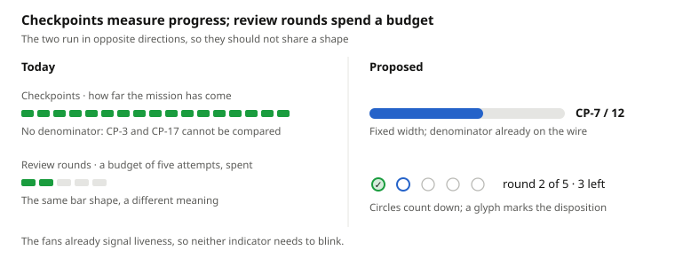

# Parallix web board — visual design review

2026-10-18 · Magnus Ekdahl

## Scope

This reviews the Parallix web board's visual design against the code in `web/src` at commit `e38bec8` (9 Oct 2026) and a screenshot of a running board.

The running build is slightly ahead of `main`: the screenshot shows a "+ Create new mission" button in the top bar that does not exist in the reviewed commit. Everything below comes from code that is in `main`.

The findings fall into two groups. Most of the visible problems trace back to one missing layout line and one missing token layer; the rest are specific and independently fixable.

## The board never fills the viewport

This is why roughly half the screen is black and the operation log floats mid-page instead of sitting at the bottom. It is a single missing style.

`Shell` makes `<main>` a `100vh` column flex container. Its child `Board` renders a bare `
` with no style, so it is a block box sized to its content. Inside it, the lane row asks for `flex: 1` and each column asks for `height: '100%'` — both resolve against an auto-height parent and do nothing. The lanes end up content-height, and everything below them rides up with them.

In `board.tsx`, giving the root div `flex: 1, display: 'flex', flexDirection: 'column', minHeight: 0` makes the existing `flex: 1` and `minHeight: 0` on the lane row start working, pins the log to the bottom, and gives each lane its own scroll region.

This one change is worth more than every other item in this review.

## There is nothing to be consistent to

Every component writes inline style objects against literal numbers, and `palette.ts` holds colors only. There is no spacing scale (4, 5, 6, 7, 8, 9, 10, 11, 14, 18 and 22 all appear, chosen per site), no radius scale (2, 3, 4, 5, 6, 20) and no type scale.

Font sizes run 8, 10, 10.5, 11, 12, 13 and 14 — seven sizes inside a six-pixel range, which reads as jitter rather than hierarchy. A card title at 13px is only 1.18x its body text at 11px, so titles do not win. The lane heading at 14px is barely above the card titles it governs. Nothing on a card establishes a first thing to read.

The modals make the same point from another direction: `CheckpointDetail` and `TerminalProgress` hardcode `#101c16`, `#2f5a3f`, `#68f6a7` and `#43e891` — a second green system that is not in `C` and does not match the board's greens.

Extending `palette.ts` into a small token module (`space`, `radius`, `size`, plus the modal greens) and collapsing to four type sizes — roughly 18 / 13 / 11 / 10 — fixes the hierarchy and stops the drift from recurring.

## Green has stopped meaning anything

Green currently marks the wordmark, agent-available dots, checkpoint pips, review pips, gate pass, every primary button, the done chevron, the grille decoration and the codex family accent (`#19b48c` is close enough to read as the same green). The eye has nowhere to land.

The checkpoint pips are the worst offender because they carry the least information per pixel. `CheckpointPips` renders one pip per checkpoint number, so a card at CP-17 draws seventeen green bars that outweigh the mission title directly above them. They are not progress — there is no denominator — so a CP-17 card looks seventeen times more finished than a CP-3 card for no reason. Either show `CP-17` as text with the pips capped at a fixed width, or drop the pips and keep the label.

The review pips sit beside them in the same 16x8 rounded-rect shape, but they mean something different and are bounded at 5. Two identical-looking rows meaning different things on different scales is the core legibility problem on the card. Give review pips a distinct form (segmented bar or dots) and reserve the bar shape for one of the two.

The progress reading is worth keeping — the objection is to the drawing, not the idea. Checkpoints count up toward completion, so they want a bounded track; review rounds count down a budget of five attempts, where a higher number is worse. Two indicators that point in opposite directions should not share a shape.

The denominator is already on the wire: `checkpointEvidence` carries the full checkpoint list, so `CP-7 / 12` is available today. `CheckpointPips` parses the number out of the name and ignores it.

Suggested rule: green is reserved for enabled actions and gate pass. Checkpoint and review indicators move to a neutral or cyan ramp.

One colour-only signal also needs a second channel: an approved review round and a changes-requested round differ by amber versus green in an identical shape.

## The same strings render two or three times

On px-0008, `px review --continue px-0008 exited with status 1` appears as the actor line, again as the blocking reason, and a third time in the attention rail. Three copies of one string in one viewport.

`recovery evidence: coordinator stopped` appears on every card at 10px in `C.faint` — a full line per card, in the least readable colour in the palette, saying the same thing everywhere. It is genuinely secondary; a small icon with the detail on hover returns a line to every card.

The same applies to `gate · unknown`. If unknown is the normal state, printing it on every card trains people to skip the gate row, which is exactly where blindness is most expensive.

## The bottom two text tiers fail contrast

Measured against the card background `#101419`. The WCAG AA minimum for body text is 4.5:1.

| Token | Hex | Ratio | Verdict |
| --- | --- | --- | --- |
| `C.faint` | `#3f4a53` | 2.1:1 | Fails badly |
| `C.dim` | `#6b7a85` | 4.2:1 | Fails |
| `C.muted` | `#8b97a1` | 6.3:1 | Passes |
| `C.red` | `#e2604e` | 5.3:1 | Passes |
| `C.green` | `#5ee08a` | 11.1:1 | Passes |

`faint` and `dim` carry the coordinator line, gate state, next-action text, lane counts, attention ranks and the entire done rail — much of it at 10px. That is the majority of the words on screen.

Lifting `faint` to around `#5a6873` and `dim` to around `#7d8b96`, and raising the 10px and 10.5px sizes to 11px, clears both thresholds without changing the character of the design.

## Smaller issues, in order of annoyance

**Empty lanes take full width.** REVIEW has zero cards and claims a third of the board (`flex: 1, minWidth: 318`) while ACTIVE squeezes three cards into the same space. Give empty in-flight lanes `flex: 0 1 180px`, or let them collapse the way the done rail already does.

**The grille hangs into the card gutter.** `Grille` draws a gold hatched strip below every card with `height: 0` and visible overflow, landing in the 22px gap. In an operations board, decoration shaped like a progress indicator is the one kind to avoid — at a glance it reads as data.

**Button rows wrap constantly.** The footer uses `flexWrap: 'wrap'` with cancel plus primary, so `Edit` ends up alone on a second line in every intake card and both integration cards. It looks like a separate control group. At the 222px intake width this is the normal case, not an edge case.

**Command outcomes land far from the card.** `outcomes` renders as paragraphs at the bottom of the board. Clicking "restart" on the top card puts the response below the fold. These belong in the footer of the card that was clicked.

**Cards are clickable with no affordance.** `selectTerminal` opens the terminal on any card click, but there is no hover, cursor or edge change anywhere in the CSS. Nothing suggests the card does anything.

**Log timestamps are raw ISO-Z.** `2026-10-16T06:53:15.965Z` in a Stockholm-local tool is constant mental arithmetic, and `phase` and `message` both print even when identical. Local `HH:mm:ss` plus deduplicated text would halve the noise in that strip.

**The fonts never load.** ADR 0054 keeps the bundle self-contained, so JetBrains Mono and Barlow Condensed fall back to Menlo and Arial Narrow on most machines — the intended pairing essentially never renders. Self-hosting two subset `.woff2` files in the bundle honours the ADR and actually delivers the typography.

**`aria-selected` on `<article>` is invalid.** It is set in `flight-column`, `intake-column` and `attention-rail`; `article` has no role that supports it, so screen readers drop it. `aria-current` works with no markup change.

## What is working and should be kept

The information model is unusually disciplined. The client derives no facts, and unknown states print as unknown rather than collapsing into success. That is rarer than it sounds, and it is the hard part.

Four other things are worth protecting through any redesign:

- The done rail's `
` disclosure is the right pattern, with no state cost to the client.
- `prefers-reduced-motion` is honoured on both the fans and the review blink.
- The red top border on blocked and failed cards is good peripheral signal.
- The two-stage cancel, with an explicit sentence about what gets deleted, is better than most production tools manage.

## Suggested order of work

The first two items make everything after them cheaper, so they should land before any cosmetic change.

1. Fix the `Board` root flex style. One line, and it recovers half the screen.
2. Extend `palette.ts` into space, radius and size tokens, and fold the modal greens into `C`. Nothing else here can be made consistent until this exists.
3. Raise `C.faint` and `C.dim`, and lift 10px and 10.5px text to 11px.
4. Rework the two pip rows: checkpoints become a fixed-width track with a real denominator, review rounds become countdown circles with a disposition glyph.
5. Collapse empty in-flight lanes.
6. Move command outcomes into the card footer that was clicked.
7. Remove or relocate the grille, add a card hover state, and dedupe the repeated status strings.
8. Self-host the two font subsets, and swap `aria-selected` for `aria-current`.
